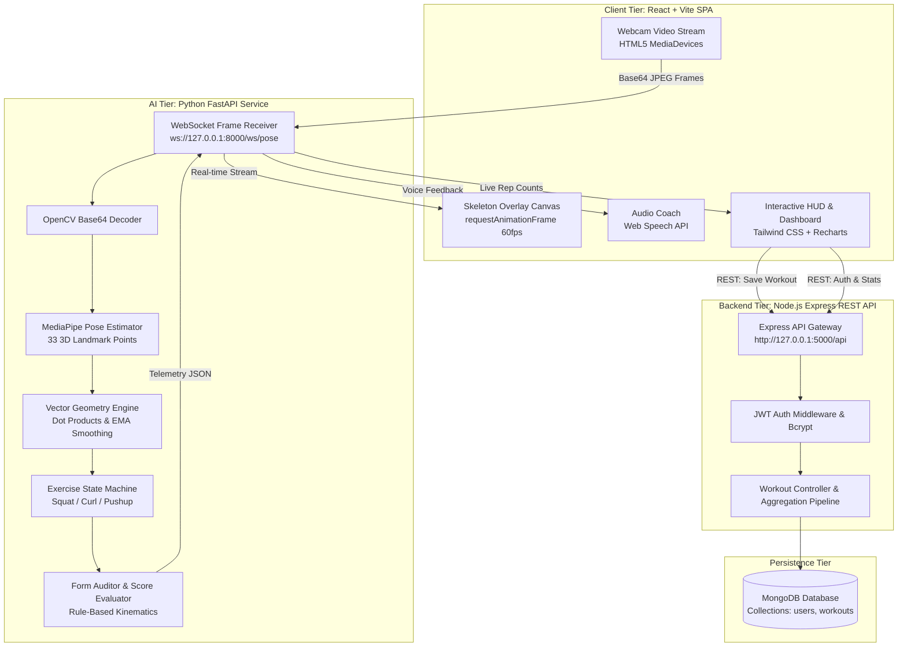

# AegisAI — Real-Time AI Gym Trainer

> **BTech Computer Science & Engineering Major Project**  
> An enterprise-grade, real-time computer vision fitness trainer that monitors body posture, tracks biomechanical joint angles, counts valid repetitions via state machines, and provides instant voice coaching through the browser webcam.

[](https://react.dev/)
[](https://tailwindcss.com/)
[](https://nodejs.org/)
[](https://mongodb.com/)
[](https://fastapi.tiangolo.com/)
[](https://developers.google.com/mediapipe)

---

## 1. System Architecture



---

## 2. Key Features

- **Real-Time 33-Point Landmark Detection**: Extracts full-body skeletal coordinates with normalized $X, Y, Z$ and visibility confidence using Google MediaPipe Pose.
- **Biomechanical Vector Mathematics**: Calculates interior joint angles using Euclidean vector dot products with floating-point clamping to eliminate numerical overflow.
- **Finite State Machine Rep Counting**: Eliminates false repetitions from camera jitter by requiring complete movement traversal (`STANDING` $\rightarrow$ `GOING_DOWN` $\rightarrow$ `BOTTOM` $\rightarrow$ `GOING_UP` $\rightarrow$ `REP_COMPLETED`).
- **Real-Time Audio Coaching**: Browser-native Web Speech API synthesizes actionable corrective cues (*"Go Lower"*, *"Keep your back straight"*, *"Rep completed!"*) with priority queue debouncing.
- **Form Fidelity Score (0-100%)**: Audits posture compliance continuously across each repetition.
- **Performance Dashboard**: Weekly progress area charts, personal best records, caloric expenditure estimates, and workout history.
- **Enterprise Security**: JWT-based stateless authentication and Blowfish `bcryptjs` password hashing with 10 salt rounds.

---

## 3. Supported Exercises & Kinematic Rules

| Exercise | Tracked Joints | Primary Angle | Target Criteria | Corrective Cues |
|---|---|---|---|---|
| **Squats** | Hip, Knee, Ankle, Shoulder | Knee Angle | $\le 100^\circ$ at bottom, Torso tilt $\le 45^\circ$ | *"Go Lower"*, *"Keep back straight"* |
| **Bicep Curls** | Shoulder, Elbow, Wrist | Elbow Angle | $\le 48^\circ$ at peak curl, $\ge 150^\circ$ at bottom | *"Curl higher"*, *"Keep elbows pinned"* |
| **Push-ups** | Shoulder, Elbow, Wrist, Hip | Elbow Angle | $\le 90^\circ$ at bottom, Plank line $155^\circ - 180^\circ$ | *"Lower chest"*, *"Tighten core / straight hips"* |

---

## 4. Project Directory Structure

```
Realtime-AI gym trainer/
├── frontend/               # React 18 + Vite + Tailwind CSS Single Page App
│   ├── src/
│   │   ├── api/            # Axios HTTP client with JWT interceptor
│   │   ├── components/     # Reusable UI (Navbar, Canvas, RepRing, MetricCards)
│   │   ├── context/        # React Auth Context (JWT session management)
│   │   ├── pages/          # Landing, Login, Register, Dashboard, Workout, History
│   │   └── utils/          # Web Speech Coach & Pose Overlay Renderer
│   ├── package.json
│   └── vite.config.js
├── backend/                # Node.js + Express + MongoDB REST API
│   ├── src/
│   │   ├── config/         # MongoDB Mongoose connection
│   │   ├── controllers/    # Auth, Workout, and Dashboard analytics controllers
│   │   ├── middleware/     # JWT authentication & global error handler
│   │   ├── models/         # Mongoose User and Workout schemas
│   │   └── routes/         # Express API routes
│   ├── server.js
│   └── package.json
├── ai-service/             # Python 3.11 + FastAPI + MediaPipe Pose Service
│   ├── app/
│   │   ├── exercises/      # Modular Squat, Bicep Curl, and Push-up analyzers
│   │   ├── detector.py     # MediaPipe Pose solution wrapper
│   │   ├── geometry.py     # 2D/3D vector dot product angle calculations & EMA
│   │   ├── rep_counter.py  # Hysteresis state machine repetition counter
│   │   └── form_analyzer.py# Biomechanical rules and form score auditor
│   ├── main.py             # FastAPI entrypoint with WebSocket pose streaming
│   ├── test_ai.py          # Unit test verification suite
│   └── requirements.txt
├── documentation/          # BTech Viva & Technical Documentation Suite
│   ├── 01_SYSTEM_ARCHITECTURE.md
│   ├── 02_AI_PIPELINE_AND_MATHEMATICS.md
│   ├── 03_DATABASE_DESIGN.md
│   ├── 04_API_SPECIFICATION.md
│   ├── 05_VIVA_QUESTIONS_AND_ANSWERS.md
│   └── 06_DEPLOYMENT_GUIDE.md
└── README.md
```

---

## 5. Local Setup & Execution Guide

### Prerequisites
- **Node.js**: v18 or higher (v24 tested)
- **Python**: v3.10 or v3.11 (v3.11.16 tested)
- **MongoDB**: Active local service on port 27017 or MongoDB Atlas connection string
- **Webcam**: Standard built-in laptop or USB webcam

---

### Step 1: Start MongoDB
Ensure your local MongoDB service is running:
```powershell
net start MongoDB
```

---

### Step 2: Start the Backend REST API
Open Terminal 1:
```bash
cd backend
npm install
npm run dev
```
*Backend runs on `http://localhost:5000`.*  
Verify health: [http://localhost:5000/api/health](http://localhost:5000/api/health)

---

### Step 3: Start the Python AI Pose Service
Open Terminal 2:
```bash
cd ai-service
# Activate virtual environment
.\venv\Scripts\activate
# Start FastAPI WebSocket server
python -m uvicorn main:app --host 127.0.0.1 --port 8000 --reload
```
*AI Service runs on `http://localhost:8000` with WebSockets on `ws://127.0.0.1:8000/ws/pose/{exercise}`.*  
Verify health: [http://localhost:8000/health](http://localhost:8000/health)

---

### Step 4: Start the Frontend Application
Open Terminal 3:
```bash
cd frontend
npm install
npm run dev
```
Open your browser and navigate to:
**[http://localhost:3000](http://localhost:3000)**

---

## 6. Running Automated Verification Tests

To verify vector mathematics, joint angle calculations, and state machine transitions:
```powershell
& "ai-service\venv\Scripts\python.exe" "ai-service\test_ai.py"
```

Expected output:
```
============================================================
Running AI Gym Trainer Biomechanics Verification Tests
============================================================
Testing Vector Angle Calculations...
 Geometry Mathematics PASSED
Testing Squat State Machine Cycle...
 Squat State Machine: Cycle completed, Reps = 1, Score = 100% PASSED
Testing Bicep Curl State Machine Cycle...
 Bicep Curl State Machine: Cycle completed, Reps = 1 PASSED
Testing Push-up State Machine Cycle...
 Push-up State Machine: Cycle completed, Reps = 1 PASSED
============================================================
ALL AI BIOMECHANICS & STATE MACHINE TESTS PASSED SUCCESSFULLY!
============================================================
```

---

## 7. BTech Viva Documentation

Detailed technical documents for review and college defense:
- [01. System Architecture & Design](documentation/01_SYSTEM_ARCHITECTURE.md)
- [02. AI Pipeline, Kinematics & Mathematics](documentation/02_AI_PIPELINE_AND_MATHEMATICS.md)
- [03. Database Design & Schemas](documentation/03_DATABASE_DESIGN.md)
- [04. REST & WebSocket API Specification](documentation/04_API_SPECIFICATION.md)
- [05. 30+ BTech Viva Questions & Authoritative Answers](documentation/05_VIVA_QUESTIONS_AND_ANSWERS.md)
- [06. Production Cloud Deployment Guide](documentation/06_DEPLOYMENT_GUIDE.md)

---

## 8. License

This project was developed as a final year BTech Major Project. Open-sourced under the MIT License.
