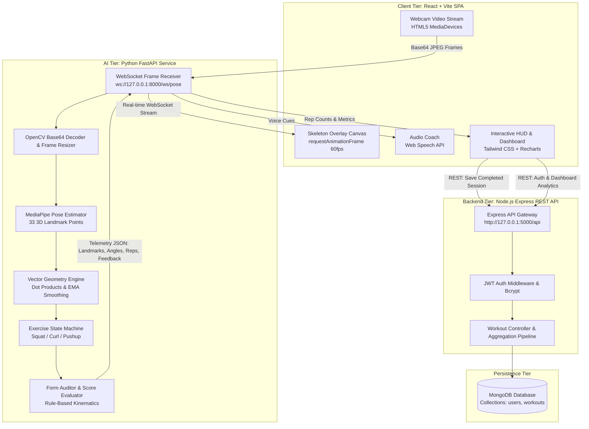

# 01. System Architecture & Design

## 1. Overview

The **Real-Time AI Gym Trainer** is an intelligent, full-stack fitness assistant engineered to provide automated repetition tracking and biomechanical posture auditing during resistance and bodyweight exercises.

The system decouples computation into three specialized tiers:
1. **Presentation & Capture Layer (Frontend)**: React 18, Vite, Tailwind CSS, HTML5 Canvas 2D overlay, and the Web Speech API.
2. **Computer Vision & Kinematics Engine (AI Service)**: Python 3.11, FastAPI, WebSocket streaming, MediaPipe Pose (33 3D landmarks), OpenCV, and NumPy.
3. **Data Management & Authentication Tier (Backend)**: Node.js, Express.js, MongoDB (Mongoose ODM), JWT token authentication, and bcryptjs.

---

## 2. Architecture Diagram

---

## 3. Component Responsibilities

### 3.1 Frontend (Presentation & Capture)
- **Webcam Ingestion**: Accesses user webcam at 30 FPS through `navigator.mediaDevices.getUserMedia`.
- **Canvas Rendering**: Renders glowing neon skeletal connectors and joint markers at 60 FPS over the video feed using hardware-accelerated Canvas 2D.
- **Audio Coach**: Converts textual biomechanics cues into synthesized speech using the browser's native `SpeechSynthesis` engine with priority queue debouncing.
- **Analytics Visualization**: Renders interactive progress charts (daily repetition volume, exercise distribution) powered by Recharts.

### 3.2 AI Computer Vision Engine
- **Decoupled WebSocket Service**: Operates on port `8000` via FastAPI/Uvicorn, ensuring camera frame processing does not block the backend database or REST APIs.
- **MediaPipe Pose Detection**: Identifies 33 bodily landmarks in normalized 3D space $(X, Y, Z)$ along with visibility confidence scores.
- **Kinematic Geometry**: Computes 3-joint angles using vector dot products, mathematically constrained to $[0^\circ, 180^\circ]$ to prevent floating-point anomalies.
- **Anti-Cheat Rep Debouncing**: Utilizes discrete multi-phase state machines with minimum duration hysteresis thresholds (e.g. $1.0\text{ s}$) to prevent double counting from rapid video noise.

### 3.3 Backend (REST & Data Tier)
- **Stateless Authentication**: Issues and validates JSON Web Tokens (JWT) signed with HMAC-SHA256. Passwords hashed with 10 salt rounds of `bcryptjs`.
- **MongoDB Aggregation Pipelines**: Computes dashboard analytics, calculating total repetitions, active workout minutes, estimated caloric expenditure, average form fidelity, and personal best records.
