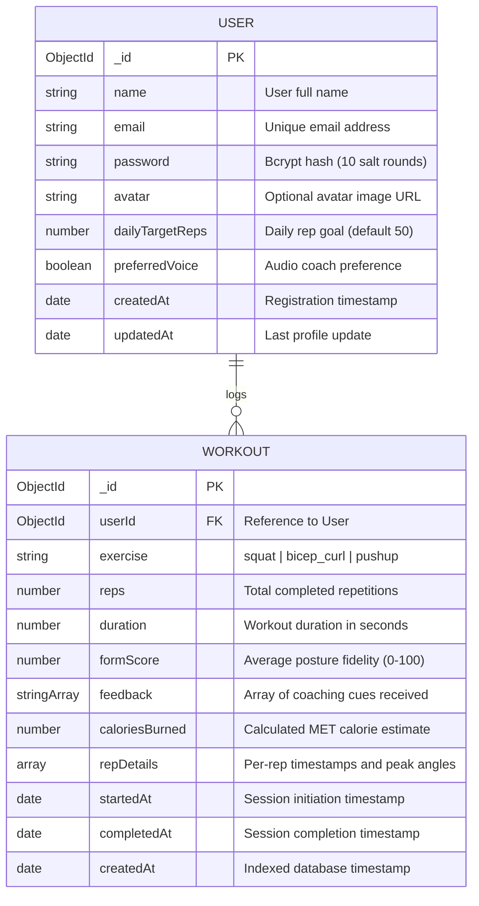

# 03. Database Design & Schemas

## 1. Overview

The backend uses **MongoDB** with the **Mongoose ODM**. MongoDB's flexible, document-oriented structure was selected because fitness telemetry produces semi-structured time-series records (e.g. rep breakdowns, varying feedback lists, dynamic timestamps).

---

## 2. Entity-Relationship (ER) Diagram



---

## 3. Detailed Schema Specifications

### 3.1 User Collection (`users`)

| Field | Type | Required | Constraints | Description |
|---|---|---|---|---|
| `_id` | `ObjectId` | Yes | Primary Key | Auto-generated document ID |
| `name` | `String` | Yes | Max 60 chars, trimmed | User's display name |
| `email` | `String` | Yes | Unique, lowercased, regex validated | Email for authentication |
| `password` | `String` | Yes | Min 6 chars, `select: false` | Bcrypt hashed password |
| `dailyTargetReps` | `Number` | No | Default `50` | User's daily rep target |
| `preferredVoice` | `Boolean` | No | Default `true` | Audio synthesizer toggle |
| `createdAt` | `Date` | Auto | ISO-8601 | Document creation timestamp |
| `updatedAt` | `Date` | Auto | ISO-8601 | Last profile modification |

---

### 3.2 Workout Collection (`workouts`)

| Field | Type | Required | Constraints | Description |
|---|---|---|---|---|
| `_id` | `ObjectId` | Yes | Primary Key | Auto-generated document ID |
| `userId` | `ObjectId` | Yes | Indexed Ref (`User`) | Foreign key linking user |
| `exercise` | `String` | Yes | Enum: `['squat', 'bicep_curl', 'pushup']` | Movement type |
| `reps` | `Number` | Yes | Min 0, default 0 | Valid reps counted |
| `duration` | `Number` | Yes | Min 0, in seconds | Active training duration |
| `formScore` | `Number` | Yes | Range: $[0, 100]$ | Biomechanical form score |
| `feedback` | `[String]` | No | Default `[]` | Coaching cues logged |
| `caloriesBurned` | `Number` | No | Default 0 | Caloric expenditure |
| `repDetails` | `[Object]` | No | Detailed logs | Per-rep peak angles & timestamps |
| `startedAt` | `Date` | Yes | Date | Session start time |
| `completedAt` | `Date` | Yes | Date | Session finish time |

---

## 4. Indexing Strategy

To support high-speed aggregation queries for user dashboards:
1. **Compound User-Date Index**:
   ```javascript
   workoutSchema.index({ userId: 1, createdAt: -1 });
   ```
   Enables instant retrieval of recent workouts sorted chronologically without in-memory sorting.
2. **Compound User-Exercise Index**:
   ```javascript
   workoutSchema.index({ userId: 1, exercise: 1 });
   ```
   Optimizes exercise-specific personal best calculations and historical breakdowns.
